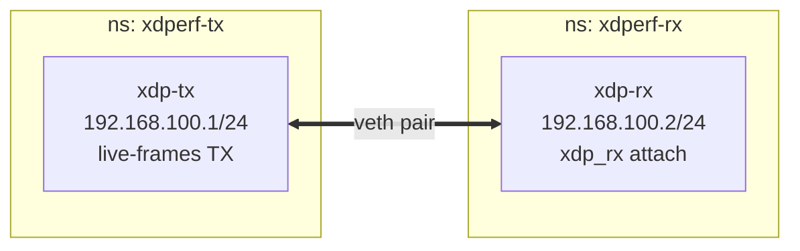

# examples — veth-based local end-to-end tests

Self-contained example scenarios that connect two network namespaces with a
veth pair, send with xdperf on one side and receive on the other, and verify
the result with **real counters**. No physical NIC or VM required — runs on a
single Linux host (including CI ubuntu runners).

For verification closer to a real NIC path with QEMU 2-VM, see
[scripts/vmlab](../scripts/vmlab/README.md).

## Prerequisites

- Linux kernel 5.18+ (XDP live-frames required; automatically SKIPs on
  unsupported kernels)
- root privileges (for netns / veth / eBPF operations)
- `iproute2`, `ethtool`, Python 3 (standard library only for TCP plugin scenarios)
- `make build` done at the repository root (`out/bin/xdperf` and `*.wasm`)
- [otlp-metrics](otlp-metrics/) only: `docker` and `curl` (SKIPs when docker is
  unavailable)

## Usage

```bash
make build

# Run all scenarios at once
sudo ./examples/run_all.sh
# or
make examples

# Run a single scenario
cd examples/simpleudp
sudo ./setup.sh
sudo ./test.sh
sudo ./teardown.sh
```

Always run teardown after a failed test as well.

## Scenarios

| Scenario | Description |
|----------|-------------|
| [simpleudp](simpleudp/) | Basic UDP send/receive. Verifies rx counter == packets sent |
| [simpleudp-vlan](simpleudp-vlan/) | UDP with an outer 802.1Q tag. Verifies counting through VLAN parsing |
| [simpleudp-echo](simpleudp-echo/) | Echo server (`--swap-resp`) round-trip. Verifies the `XDP_TX` return path over veth |
| [simpleudp-no-rx-attach](simpleudp-no-rx-attach/) | Negative case: without peer XDP attach (and GRO off) packets are silently dropped; with GRO on they arrive |
| [simpleudp-xdp-generic](simpleudp-xdp-generic/) | Forced generic (SKB) mode via `--xdp-mode generic` on both sides. Verifies the attach mode and end-to-end delivery |
| [simpleudp-split-rx](simpleudp-split-rx/) | One process with `--rx-device`: TX on one veth, forwarded by a middle "DUT" netns, counted by `xdp_rx` on a second veth |
| [srv6](srv6/) | SRv6 (RFC 8754) traffic via the srv6.go plugin, all three encapsulation modes (`l3vpn_ipv4`/`l2vpn_eth`/`ipv6`). Verifies rx counter == packets sent per mode |
| [tcpstream](tcpstream/) | `xdperf run --tcp` (XDP-implemented TCP client) streaming into `xdperf-sink` (kernel TCP) and into `xdperf run --tcp-server` (XDP responder) over IPv4, IPv6 and both with an 802.1Q tag, plus `socat` (kernel TCP) into the XDP responder. Verifies sender `bytes_acked` == receiver bytes and connection counts |
| [mixed](mixed/README.md) | Weighted DNS-style UDP packets and unequal TCP byte targets, with TCP flow CSV and UDP echo verification |
| [tcp-template](tcp-template/README.md) | TCP base frames, IPv4/IPv6, VLAN/QinQ, and static options |
| [tcp-vxlan](tcp-vxlan/README.md) | TCP through Linux VXLAN with IPv4/IPv6 and outer UDP zero/LCO checksums |
| [tcp-tunnels](tcp-tunnels/README.md) | GRE, IPIP, SRv6, MPLS, GTP-U, and asymmetric replies |
| [tcp-payload](tcp-payload/README.md) | Timestamps, payload patterns, per-flow source IPs, and ACK loss |
| [otlp-metrics](otlp-metrics/) | OTLP metrics push (`--otlp-endpoint`) to an OTel Collector in docker. Verifies the exported counters via the prometheus exporter. SKIPs without docker |

## Veth queues

The common veth helper uses one RX/TX queue by default. Set `VETH_QUEUES`
when running setup, for example:

```bash
sudo env VETH_QUEUES=8 ./examples/tcpstream/setup.sh
```

Workers sharing a peer receive ring can overflow it at high rates. Queue
selection depends on the sending CPU modulo the peer RX queue count, so
choose CPU IDs as well as enough queues to avoid collisions. xdperf warns
when workers exceed its own veth’s active RX queue count, used as an estimate
for the peer; it does not inspect the peer across namespaces.
See the [veth tuning notes](../docs/ja/tips.md) for `ethtool -L` and active
versus allocated queue counts.

## How it works

The following describes the basic UDP scenarios. TCP and mixed scenarios
attach their own receive programs and use sinks or Linux tunnel devices.



- The sender does not attach XDP to the device; it transmits from the veth via
  `BPF_PROG_RUN` live-frames
- The receiver attaches the `xdp_rx` program, which counts IPv4/IPv6 frames and
  DROPs them
- The veth XDP TX path requires the peer's NAPI to be active (an XDP program
  attached on the peer, or GRO enabled — the latter since kernel v5.13,
  `d3256efd8e8b` "veth: allow enabling NAPI even without XDP") — otherwise
  frames are silently dropped
  ([XDP ate my packets](https://fedepaol.github.io/blog/2023/09/11/xdp-ate-my-packets-and-how-i-debugged-it)).
  This is why the **receive server is started first**; the requirement itself
  is measured by [simpleudp-no-rx-attach](simpleudp-no-rx-attach/), and the
  reverse direction (echo `XDP_TX` back toward the sender, which xdperf covers
  by attaching `xdp_pass_dummy`/`xdp_rx` to its own device while sending) by
  [simpleudp-echo](simpleudp-echo/)
- Verification uses the delta of the receiver veth's `ethtool -S` counters
  (sum of `rx_queue_N_xdp_packets`)
- IPv6 is disabled during setup (kernel-originated IPv6 frames would otherwise
  break the exact-match comparison)

## Adding a new scenario

Put a directory containing `test.sh` directly under examples/ and
`run_all.sh` will pick it up. Include `README.md`, `setup.sh` and `teardown.sh`;
the runner executes setup, test and teardown in sequence and cleans up after
failures. Source the helpers in [common/](common/) (`udp_scenario.sh`,
`tcp_scenario.sh` or `tcp_plugin_scenario.sh`) for topology and process handling.
Keep Python code in `.py` files with argparse CLIs, using only the standard
library. Shared configuration, UDP echo and CSV/statistics checks live in
[common/py](common/py/). Run their tests without root:

```bash
python3 -m unittest discover -s examples/common/py -v
```

`test.sh` exit codes: `0` = PASS, `3` = SKIP (e.g. kernel without
live-frames support), anything else = FAIL.
