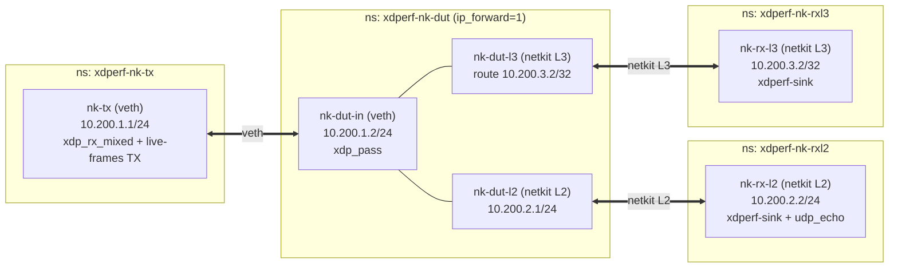

# tcp-netkit — TCP and mixed UDP+TCP into `netkit` (L2 and L3) Pod namespaces

Exercises xdperf against Linux `netkit` virtual devices (introduced in Linux
6.7 and used by Cilium's `bpf.datapathMode=netkit`).

Because `netkit` deliberately omits `XDP_SETUP_PROG` and `ndo_xdp_xmit`,
`BPF_F_TEST_XDP_LIVE_FRAMES` cannot transmit directly from a `netkit` device.
Instead, this scenario models a Kubernetes node datapath where xdperf sends from
an ingress `veth` (or physical NIC / SR-IOV VF) and the host routes packets
into receiver Pod namespaces connected via `netkit` pairs in both **L2** and
**L3** modes.

## Topology



## Cases

1. **Guardrail check**: Running `xdperf run` as a sender directly on `nk-rx-l2`
   (`netkit`) fails immediately with an explicit `ndo_xdp_xmit` error rather
   than falling back to generic XDP and silently dropping frames.
2. **`netkit` L3 TCP stream (`tcpflow.go`)**: Sends `FLOWS` (16) concurrent TCP
   connections of `BYTES` (65,536) bytes into `xdperf-sink` inside the L3
   `netkit` namespace and verifies the flow report CSV against the sink's
   accepted/closed connections and byte count.
3. **`netkit` L2 mixed UDP + TCP (`mixed.go`)**: Sends weighted DNS-style UDP
   packets and four unequal TCP flows into the L2 `netkit` namespace and
   verifies UDP echo counts, TCP flow completion, and opportunity ratios via
   `examples/common/py/verify.py`.
4. **`netkit` L3 BPF redirect fastpath (`-netkit-fastpath`)**: Attaches a TCX
   ingress `bpf_redirect_peer` program on `nk-dut-in` and a `BPF_NETKIT_PEER`
   `bpf_redirect_neigh` program on `nk-dut-l3` (matching Cilium's
   `bpf.datapathMode=netkit` zero-backlog path) and verifies `FLOWS` concurrent
   TCP connections end to end.

## Run

```bash
sudo ./examples/tcp-netkit/setup.sh
sudo ./examples/tcp-netkit/test.sh
sudo ./examples/tcp-netkit/teardown.sh
```

Automatically returns exit code `3` (SKIP) on kernels or `iproute2` builds
without `netkit` support.
