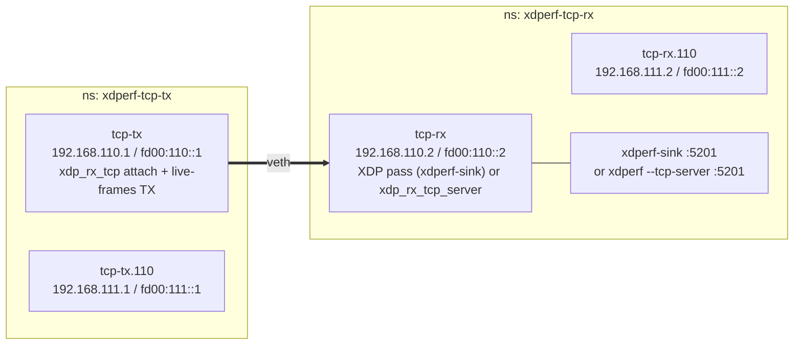

# tcpstream — XDP TCP client (`--tcp`) and XDP TCP responder (`--tcp-server`)

`xdperf run --tcp` opens real TCP connections from XDP: SYN, data segments,
retransmissions and FIN are all generated by `xdp_tx_tcp` (driven by
BPF_PROG_RUN live frames) and the peer's SYN-ACK / ACK / FIN are handled by
`xdp_rx_tcp` attached to the same device. No kernel TCP socket is involved on
the sender. Two receivers are exercised: `xdperf-sink`, a plain Go TCP server
that counts connections and bytes (normal kernel stack), and
`xdperf run --tcp-server`, the XDP responder that answers SYN / data / FIN
from XDP without a socket either. The `linux*` cases go the other way: a
kernel TCP client (`socat`) streams into the XDP responder.
Design notes: [docs/ja/design_xdp_tcp.md](../../docs/ja/design_xdp_tcp.md).

## Topology



## Cases

| case | destination | xdperf flags |
|---|---|---|
| `v4` | `192.168.110.2:5201` | |
| `v6` | `[fd00:110::2]:5201` | |
| `v4vlan` | `192.168.111.2:5201` | `--tcp-vlan-id 110` |
| `v6vlan` | `[fd00:111::2]:5201` | `--tcp-vlan-id 110 --tcp-vlan-pcp 3` |
| `v4srv` / `v6srv` | same as `v4` / `v6` | receiver is `xdperf run --tcp-server` |
| `v4vlansrv` / `v6vlansrv` | same as `v4vlan` / `v6vlan` | receiver is `--tcp-server --tcp-vlan-id 110` |
| `v4ack2srv` | `192.168.110.2:5201` | receiver is `--tcp-server --tcp-listen :5201 --tcp-ack-every 2` |
| `linux4` / `linux6` | `socat` → `192.168.110.2:5201` / `[fd00:110::2]:5201` | one kernel-TCP connection of `FLOWS*BYTES` bytes into `--tcp-server` |
| `v4loss` | `192.168.110.2:5201` | like `v4`, with `LOSS_PCT` (1)% loss each way on the sink's veth (netem egress + tc gact random drop on ingress) |
| `linux4loss` | `socat` → `192.168.110.2:5201` | like `linux4`, with the same loss on the client's veth |
| `v4bigsrv` | `192.168.110.2:5201` | XDP on both ends, 1 flow of `BIG_BYTES` (5g), window `BIG_WINDOW` (64): more than 4 GiB on one connection, so the 32-bit sequence space wraps |
| `v6manysrv` | `[fd00:110::2]:5201` | XDP on both ends, `MANY_FLOWS` (64) concurrent flows of `MANY_BYTES` (64m), window `BIG_WINDOW` (64) |

Each `--tcp` case sends `FLOWS` (16) connections of `BYTES` (1m) (the two large cases use their own sizes, see above) and passes
when the sender reports `done == FLOWS`, `failed == 0`,
`bytes_acked == FLOWS*BYTES` and the receiver (sink or responder) reports the
same number of accepted/closed connections and bytes (and, for the
responder, `unexpected == 0` and retransmissions below 1% of the data
segments, since no loss is injected there). The `linux*` cases pass when the responder
counted one accepted and closed connection of `FLOWS*BYTES` bytes.

```bash
sudo ./setup.sh
sudo ./test.sh            # FLOWS=64 BYTES=10m WINDOW=8 CASES="v4 v4srv linux4" ./test.sh
sudo ./teardown.sh
```

## veth-specific notes

- **XDP pass program on the receive veth.** `xdperf-sink -xdp-pass-dev tcp-rx`
  attaches a two-instruction `XDP_PASS` program. veth only wakes the peer's
  NAPI for `XDP_TX`'d frames when that peer has an XDP program
  (`veth_xdp_flush` checks `rq->xdp_prog`), so without it the sender's last
  ACK of every connection stays in the ring and the sink is left in
  `LAST-ACK`. Real NICs do not need this. The `--tcp-server` cases need no
  trick (the responder is itself an XDP program); the `linux*` cases need
  it on the *transmit* veth instead, which the script does by running
  `xdperf-sink -proto udp -xdp-pass-dev tcp-tx` as a mere attacher.
- **One queue per sender CPU.** The setup creates a single-queue veth pair
  by default. With `--parallelism N > 1`, workers on different CPUs push
  live frames into the same 256-entry `xdp_ring` of the peer and overflow it
  (`tx_queue_0_xdp_xmit_errors` in `ethtool -S`), which TCP turns into
  retransmissions; xdperf warns about it at startup. Run the setup with
  `VETH_QUEUES=N` (or more) to give each worker its own queue: on one box
  this took a 64-flow run from 8.7 Gbps with one worker to 81.8 Gbps with
  eight, with no retransmissions.
- **Lost final ACKs.** With many flows the veth ring also drops some of the
  sender's final ACKs. The responder has no timer to retransmit its FIN+ACK;
  its control-plane sweeper retires such `LAST-ACK` entries after
  `--tcp-sweep-after` (and at shutdown) and counts them as closed (`closed_implicit` in the final
  statistics), so `closed` still matches `FLOWS`.
- **VLAN tags are hwaccel on veth.** The sink's kernel puts the 802.1Q tag in
  skb metadata, so `xdp_rx_tcp` sees untagged frames; it accepts them on the
  L3/L4 match and pushes the tag back into the ACKs it returns. The same
  happens on real NICs with `rx-vlan-offload on`.
- **Injecting loss.** XDP_TX and live frames bypass the qdisc layer, so
  netem on the XDP side never drops anything. The loss cases add it where
  the kernel stack sends (netem on egress) and receives (tc `gact` random
  drop on ingress, after the pass-through XDP program).
- **Losses.** The veth `xdp_ring` holds 256 frames; a burst from the sender
  overflows it (visible as `RX dropped` on the receive veth) and the tagged
  path drains more slowly than the untagged one. Expect retransmissions in
  the VLAN cases; `WINDOW` keeps them bounded. They do not affect the
  byte-count comparison because every lost segment is retransmitted.

## Wasm heavy hitter

Build `plugins/heavyhitter.go` with `make build-plugins` (or use the Go command
in [tcp_stream.md](../../docs/ja/tcp_stream.md)), then run:

```bash
sudo ./setup.sh
sudo ./heavyhitter.sh
sudo env HH_CASES='linux6 linux4vlan linux6vlan xdp6 xdp4vlan xdp6vlan loss4' ./heavyhitter.sh
sudo ./teardown.sh
```

The default cases are `linux4` and `xdp4`. Each case sends four flows with
byte targets `[65536, 65536, 65536, 67108864]` from the Wasm plugin, using MSS
1024 and one worker. The test checks the existing CSV's `bytes_acked`,
`tx_data` (`[64, 64, 64, 65536]`), and terminal state, plus the receiver's
four accepted/closed connections and 67,305,472 bytes. `loss4` also requires
nonzero `tx_rtx`. Reports and sender logs remain under
`/run/xdperf-examples/heavyhitter-<case>.{csv,log}`.
